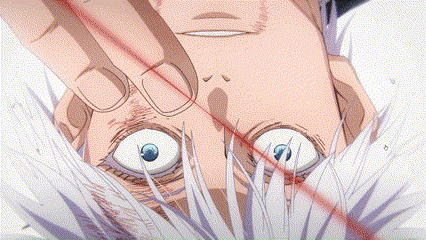
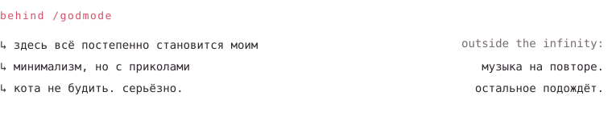

✦ welcome to my little hideout ✦

<picture><source media="(prefers-color-scheme: dark)" srcset="assets/bio-dark.svg"></picture>

<picture><source media="(prefers-color-scheme: dark)" srcset="assets/badges-dark.svg"></picture>

<picture><source media="(prefers-color-scheme: dark)" srcset="assets/starry-cat-dark.svg"></picture>

 

<strong>水</strong> Between heaven and earth, I alone am worthy <strong>水</strong>

